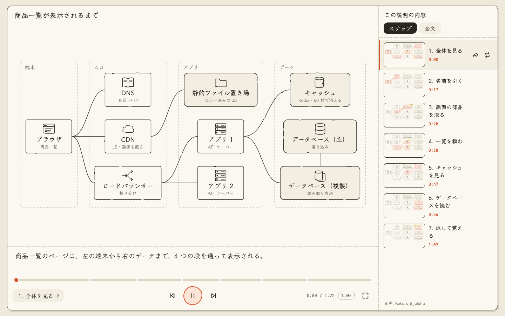

# etoki

**English:** etoki turns "explain how this works" into a one-page HTML walkthrough: hand-drawn diagrams that light up step by step, with narration generated locally (Kokoro, no API key). Install it as a Claude Code or Codex plugin and just ask the agent to explain something. Narration is Japanese for now.

名前は日本語の「絵解き」から取りました。絵を見せながら、声で語って説明することです。

仕組みを、手書き風の図と読み上げの音声で説明する 1 枚のページ（HTML）を作る道具です。Claude Code や Codex に「この仕組みを図と音声で説明して」と頼むと、AI がデータファイルを書き、道具がページを組み立てます。



## できること

- 箱を「何列目の何段目」で書くだけで、座標と線の通り道を道具が決める
- 文ごとに、光らせる線・線の上の札・箱のそばの付箋を出す
- 読み上げの音声を手元で作ってページに埋め込む（Kokoro。API の鍵は要らない）
- 箱の重なり、線が箱を突き抜けていないか、文字のはみ出し、付箋の重なりを組み立てるときに調べる
- 再生画面: ステップの一覧と全文、シークバー、速さの切り替え、全画面、1 ステップの繰り返し

## 使い方

### Claude Code に入れる

```
/plugin install etoki --marketplace nishimoto265/etoki
```

古い Claude Code では 2 行に分けて入れます。

```
/plugin marketplace add nishimoto265/etoki
/plugin install etoki@etoki
```

### Codex に入れる

```bash
codex plugin marketplace add nishimoto265/etoki
codex plugin add etoki@etoki
```

### 頼み方

入れたら、会話で頼むだけです。

```
この仕組みを図と音声で説明して
```

必要なもの: Node.js 20 以上。動画も作るなら ffmpeg。

### コマンドとして

```bash
node bin/etoki.js build examples/shop/etoki.yaml
```

`examples/shop/etoki.html` ができます。

| 指定 | 意味 |
|---|---|
| `--voice kokoro:jm_kumo` | 声を変える（`none` で音声なし、`browser` で見る人のブラウザに読ませる） |
| `--shots 0,3,7` | 指定した文の画面を PNG に撮る |
| `--video` | mp4 も作る（ffmpeg が要る） |
| `--no-check` | 崩れの検査をしない |

声の聞き比べ: `node bin/etoki.js voices`

## 初めて使うとき

次のものを、初めて使うときに 1 回だけダウンロードします。

| もの | 大きさ | 置き場所 |
|---|---|---|
| 道具の部品（プラグインとして入れた場合） | 約 330 MB | `~/.cache/etoki/deps` |
| 読み上げのモデル | 約 330 MB | `~/.cache/etoki/models` |
| 検査用のブラウザ | 約 100 MB | Playwright の置き場所 |

作った音声は文ごとに `~/.cache/etoki/audio` に残ります。直した文だけ作り直すので、2 回目からは速くなります。

読み上げの速さの目安（約 75 秒の音声、16 文）: Apple M3 Pro で 13 秒。同じ Mac で使うスレッドを 2 本に絞ると 25 秒、1 本で 45 秒。メモリは約 1.3 GB 使います。

## 設定

`~/.config/etoki/config.yaml`

```yaml
voice: kokoro:jf_alpha
```

`~/.config/etoki/readings.yaml` に読み方を足せます（例: `Kafka: カフカ`）。`~/.config/etoki/icons/` に SVG を置くと、そのファイル名で絵として使えます。

## データファイルの書き方

`skills/etoki/SKILL.md` と `examples/` を見てください。

| 例 | 箱 | ステップ |
|---|---|---|
| `examples/dns` 名前から IP アドレスを引くまで | 6 | 7 |
| `examples/shop` 商品一覧が表示されるまで | 10 | 7 |
| `examples/video` 動画がアップロードから再生されるまで | 17 | 9 |

## 検査

```bash
npm test
```

日本語の読みの変換が、元にした Python 版（misaki）と同じ結果になるかを調べます。

## ライセンス

MIT。使っているものとそのライセンスは `NOTICE.md` にあります。
