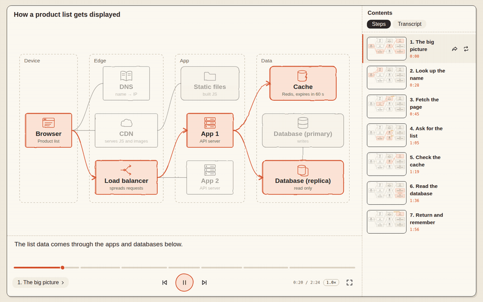

# etoki

English | [日本語](README.ja.md)

The name comes from the Japanese word *etoki* (絵解き): explaining something by showing pictures and telling the story out loud.

etoki turns "explain how this works" into a one-page HTML walkthrough. Ask Claude Code or Codex to explain a system with a diagram and voice; the agent writes a small data file, and etoki builds the page: a hand-drawn diagram that lights up step by step, with narration generated on your machine.



## What it does

- You place boxes by column and row; etoki works out the coordinates and routes the arrows
- Each sentence can light up arrows, put a label on an arrow, and stick a note next to a box
- Narration is generated locally with Kokoro and embedded in the page (no API key)
- Every build checks for overlapping boxes, arrows crossing boxes, text overflowing boxes, and overlapping notes
- Player: step list and full transcript, a seek bar with hover previews, speed control, fullscreen, loop a step, and zoom into details

Japanese and English are supported. Write `lang: en` in the data file to get an English voice, English player labels, and English pronunciation.

## Install

### Claude Code

```
/plugin install etoki --marketplace nishimoto265/etoki
```

On older versions of Claude Code, use two lines:

```
/plugin marketplace add nishimoto265/etoki
/plugin install etoki@etoki
```

### Codex

```bash
codex plugin marketplace add nishimoto265/etoki
codex plugin add etoki@etoki
```

### Use it

Once installed, just ask in the conversation:

```
Explain how this works with a diagram and voice
```

Requirements: Node.js 20 or later. ffmpeg if you also want an mp4.

### From the command line

```bash
node bin/etoki.js build examples/shop/etoki.yaml
```

This writes `examples/shop/etoki.html`.

| Option | Meaning |
|---|---|
| `--voice kokoro:jm_kumo` | Change the voice (`none` for no audio, `browser` to let the viewer's browser read it aloud) |
| `--shots 0,3,7` | Save screenshots of the given sentences as PNG |
| `--video` | Also write an mp4 (needs ffmpeg) |
| `--no-check` | Skip the layout check |

Compare voices: `node bin/etoki.js voices --lang en`

## First run

These are downloaded once, the first time you use etoki:

| What | Size | Where |
|---|---|---|
| Runtime packages (when installed as a plugin) | about 330 MB | `~/.cache/etoki/deps` |
| Narration model | about 330 MB | `~/.cache/etoki/models` |
| Browser for the layout check | about 100 MB | Playwright's browser folder |

Generated audio is cached per sentence in `~/.cache/etoki/audio`. Only changed sentences are generated again, so later builds are fast.

Narration speed (about 75 seconds of audio, 16 sentences): 13 seconds on an Apple M3 Pro; 25 seconds limited to 2 threads, 45 seconds with 1 thread. Uses about 1.3 GB of memory.

## Settings

`~/.config/etoki/config.yaml`

```yaml
voice: kokoro:jf_alpha
voice_en: kokoro:af_heart
```

Add readings in `~/.config/etoki/readings.yaml` (for example `Kafka: カフカ`). Put SVG files in `~/.config/etoki/icons/` to use them as icons by file name.

## Writing the data file

See `skills/etoki/SKILL.md` and `examples/`.

| Example | Boxes | Steps |
|---|---|---|
| `examples/dns` Looking up an IP address from a name | 6 | 7 |
| `examples/shop` How a product list gets displayed | 10 | 7 |
| `examples/video` From video upload to playback | 17 | 9 |
| `examples/shop-en` How a product list gets displayed (English) | 10 | 7 |

## Tests

```bash
npm test
```

Checks that the Japanese reading conversion matches the Python original (misaki), and that English text is converted to phonemes.

## License

MIT. Third-party components and their licenses are listed in `NOTICE.md`.
